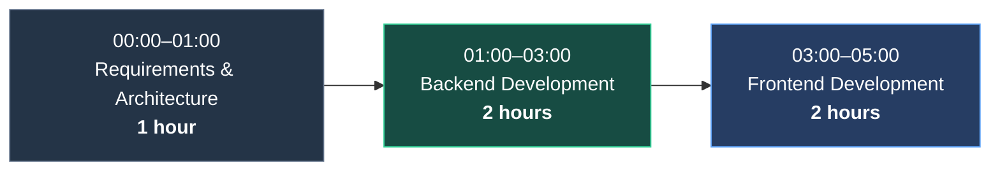

# Implementation Notes

## Project Documentation

Installation instructions, setup requirements, architecture, and technical details are documented in the README files within the respective project directories.

- **Backend:** [`backend/README.md`](backend/README.md)
- **Frontend:** [`frontend/README.md`](frontend/README.md)

Please refer to these files for dependency installation, configuration, and local development instructions.

## Estimated Development Time

The complete task took approximately **5 hours**, including requirement analysis, architecture planning, implementation, and basic verification.

### Development Timeline

The following timeline illustrates the estimated allocation of the total development effort. Time ranges represent elapsed time within the estimated 5-hour workflow, not verified clock times.

### Time Allocation

| Phase | Estimated time | Main activities |
|---|---:|---|
| Requirements and architecture | 1 hour | Understanding the requirements, defining the application structure, planning the data model, API, and data flow |
| Backend development | 2 hours | Laravel setup, database models and migrations, external API integration, data synchronization, REST API, validation, feature tests, and CI workflow |
| Frontend development | 2 hours | React and TypeScript setup, API integration, reusable components, episode listing, filtering, sorting, pagination, styling, and loading/error states |
| **Total** | **5 hours** | |

These figures are approximate estimates of the overall effort, rather than exact measurements of active coding time.

## Development Process

The implementation was organized into smaller, focused changes and committed incrementally using Git. The work was separated into backend and frontend branches, with pull requests used to integrate changes into the main branch.

The commit history provides a more detailed view of the implementation sequence, including:

- Laravel initialization and database structure.
- External API client and data synchronization services.
- REST API endpoints, request validation, resources, and feature tests.
- CI workflow configuration and backend documentation.
- React and TypeScript initialization.
- Episode listing, filtering, sorting, pagination, and reusable UI components.
- Frontend documentation and footer implementation.

GitHub commit history can be used as a reference for the individual implementation steps. Commit timestamps indicate when changes were recorded, but they should not be interpreted as exact measurements of time spent on each task.

## Architecture Overview

The application is divided into two main parts.

### Backend

A Laravel application responsible for retrieving and synchronizing external Rick and Morty API data, persisting it in the database, and exposing a paginated REST API with filtering and sorting.

### Frontend

A React and TypeScript application responsible for presenting episode data, managing user interactions, and communicating with the backend API.

This separation keeps data management and application logic on the backend while allowing the frontend to focus on presentation and user experience.

## Summary

The application was implemented in approximately five hours, with one hour allocated to understanding the requirements and planning the architecture, followed by approximately two hours each for backend and frontend development. The README files provide the detailed technical documentation, while the Git history records the implementation steps.
