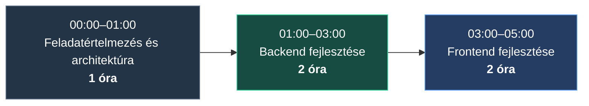

# Megvalósítási jegyzetek

## Projekt dokumentációja

A telepítéshez, konfiguráláshoz, futtatáshoz és az architektúra megismeréséhez szükséges információk a megfelelő projektmappákban található README-fájlokban érhetők el.

- **Backend:** [`backend/README.md`](backend/README.md)
- **Frontend:** [`frontend/README.md`](frontend/README.md)

Ezek a dokumentumok részletes útmutatást nyújtanak a függőségek telepítéséhez, az alkalmazás konfigurálásához és a helyi fejlesztői környezet elindításához.

## Becsült fejlesztési idő

A teljes feladat megvalósítása hozzávetőlegesen **5 órát** vett igénybe, beleértve a követelmények értelmezését, az architektúra megtervezését, a fejlesztést és az alapvető ellenőrzéseket.

### Fejlesztési idővonal

Az alábbi idővonal a teljes fejlesztési ráfordítás becsült megoszlását szemlélteti. Az időpontok a munkafolyamat kezdetétől számított relatív időt jelölik, nem tényleges óra szerinti időpontokat.

### Időráfordítás részletezése

| Munkafázis | Becsült idő | Főbb tevékenységek |
|---|---:|---|
| Feladatértelmezés és architektúra | 1 óra | Követelmények megértése, alkalmazásstruktúra kialakítása, adatmodell, API és adatfolyam megtervezése |
| Backend fejlesztése | 2 óra | Laravel inicializálása, adatbázismodellek és migrációk, külső API-integráció, adatszinkronizáció, REST API, validáció, funkcionális tesztek és CI-folyamat |
| Frontend fejlesztése | 2 óra | React és TypeScript inicializálása, API-integráció, újrafelhasználható komponensek, epizódlista, szűrés, rendezés, lapozás, felhasználói felület, betöltési és hibakezelési állapotok |
| **Összesen** | **5 óra** | |

Az időadatok hozzávetőleges becslések, nem az aktív fejlesztési idő pontos mérései.

## Fejlesztési folyamat

A megvalósítás kisebb, jól elkülöníthető lépésekben történt. A változtatások Git-commitok formájában kerültek rögzítésre, a backend és a frontend fejlesztése külön brancheken zajlott, az integráció pedig pull requesteken keresztül történt.

A GitHub commitelőzményei részletesebben is bemutatják a fejlesztés menetét, többek között az alábbi lépéseket:

- Laravel-projekt inicializálása és az adatbázis struktúrájának kialakítása.
- Külső API-kliens és adatszinkronizációs szolgáltatások létrehozása.
- REST API-végpontok, kérésvalidáció, API-erőforrások és funkcionális tesztek megvalósítása.
- CI-folyamat konfigurálása és backend-dokumentáció elkészítése.
- React- és TypeScript-alapú frontend inicializálása.
- Epizódlista, szűrés, rendezés, lapozás és újrafelhasználható felületi komponensek megvalósítása.
- Frontend-dokumentáció és lábléc elkészítése.

A commitelőzmények segítségével nyomon követhető az egyes fejlesztési lépések sorrendje. A commitok időbélyegei azonban a változtatások rögzítésének időpontját mutatják, nem pedig az adott feladatra fordított pontos munkaidőt.

## Architektúra áttekintése

Az alkalmazás két fő részből áll.

### Backend

A Laravel-alapú backend felel a külső Rick and Morty API adatainak lekéréséért és szinkronizálásáért, az adatok adatbázisban történő tárolásáért, valamint a szűrést, rendezést és lapozást támogató REST API biztosításáért.

### Frontend

A React és TypeScript alapú frontend feladata az epizódadatok megjelenítése, a felhasználói interakciók kezelése, valamint a backend API-val történő kommunikáció.

A rétegek szétválasztásával az adatkezelés és az alkalmazáslogika a backendben marad, míg a frontend a megjelenítésre és a felhasználói élményre összpontosít.

## Összefoglalás

A teljes alkalmazás megvalósítása hozzávetőlegesen 5 órát vett igénybe. Ebből körülbelül 1 óra jutott a követelmények megértésére és az architektúra megtervezésére, majd 2-2 óra a backend és a frontend fejlesztésére.

A részletes technikai dokumentációt a backend és frontend mappák README-fájljai tartalmazzák, míg a GitHub commitelőzményei a fejlesztés lépéseit mutatják be.
